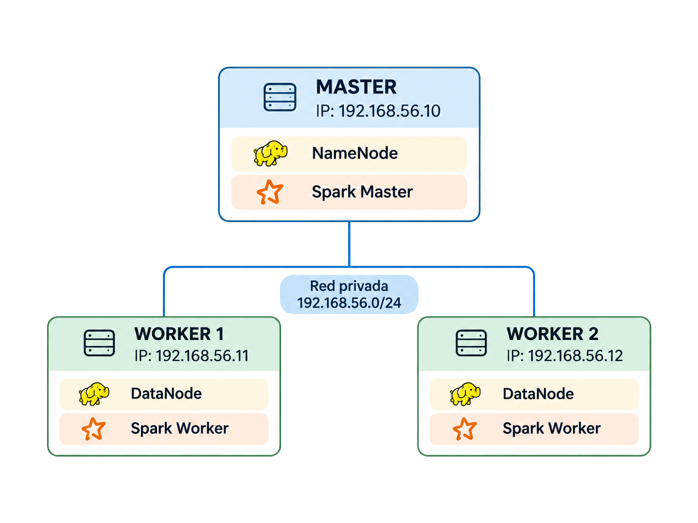

# Práctica 1 — Infraestructura Big Data virtualizada

## Integrantes:
- **José Francisco Gómes-Calcerrada Álvarez**
- **Johann Ismael Ordoñez Echeverría**

## Arquitectura

El clúster utiliza una red privada `192.168.56.0/24` y tres nodos Ubuntu 22.04 (`ubuntu/jammy64`):

| Nodo | IP privada | Recursos de VM | Contenedores y función |
| --- | --- | --- | --- |
| **master** | `192.168.56.10` | 2 vCPU, 2048 MB RAM | `namenode`: HDFS NameNode; `spark-master`: Spark Master |
| **worker1** | `192.168.56.11` | 1 vCPU, 1536 MB RAM | `datanode`: HDFS DataNode; `spark-worker`: Spark Worker |
| **worker2** | `192.168.56.12` | 1 vCPU, 1536 MB RAM | `datanode`: HDFS DataNode; `spark-worker`: Spark Worker |



## Tecnologías y requisitos previos

- **Vagrant y VirtualBox:** infraestructura virtual
- **Windows con WSL y Ansible:** entorno de trabajo configurado y autimatización
- **Docker:** ejecución de los servicios del clúster
- **HDFS y Spark:** servicios Big Data distribuidos en contenedores Docker

> **Alcance de portabilidad:** el despliegue con un solo comando está comprobado en **Windows + WSL + VirtualBox**. El trigger actual depende de `wsl.exe`

## 1. Arranque de la infraestructura

En Git Bash o en una terminal de Windows, desde la raíz del proyecto:

```bash
vagrant up
```

Estado de las VMs:

```bash
vagrant status
```

> Para un despliegue completo, ejecutar **`vagrant up` sin especificar una VM**. La automatización actual se desencadena al finalizar el arranque de `worker2`, definido como el último nodo.

## 2. Aprovisionamiento y comprobaciones con Ansible

El aprovisionamiento se ejecuta automáticamente.

```bash
ansible-playbook -i ansible/inventory/hosts.ini ansible/site.yml
```

Comprobar conectividad con las tres VMs y la versión de Docker:

```bash
ansible -i ansible/inventory/hosts.ini all -m ping
ansible -i ansible/inventory/hosts.ini bigdata -m command -a "docker --version"
```

Comprobar los seis contenedores:

```bash
ansible -i ansible/inventory/hosts.ini bigdata -b -m command -a "docker ps"
```

Comprobar que HDFS reconoce los dos DataNodes:

```bash
ansible -i ansible/inventory/hosts.ini masters -b -m command -a "docker exec namenode hdfs dfsadmin -report"
```

## 3. Interfaces web de monitorización

Una vez desplegado todo:

- HDFS NameNode: http://192.168.56.10:9870 (pestaña Datanodes para ver los 2 nodos vivos).
- Spark Master: http://192.168.56.10:8080 (sección Workers para ver los 2 workers en estado ALIVE).

## 4. Subir un fichero a HDFS y verificar la replicación

Conectarse al master desde la máquina anfitriona y entrar en el contenedor NameNode:

```bash
vagrant ssh master
sudo docker exec -it namenode bash
```

Crear el directorio, subir el fichero y verificar:

```bash
hdfs dfs -mkdir -p /user/datos
echo "Prueba de almacenamiento en HDFS" > /tmp/archivo_prueba.txt
hdfs dfs -put /tmp/archivo_prueba.txt /user/datos/archivo_prueba.txt
hdfs dfs -ls /user/datos
```

Comprobar que la réplica del bloque existe en los dos workers:

```bash
hdfs fsck /user/datos/archivo_prueba.txt -files -blocks -locations
```

## 5. Ejecutar un Job Spark en el clúster

El script `scripts/spark_job.py` lee el archivo desde HDFS, reparte el procesamiento en cuatro particiones y escribe un conteo de palabras en HDFS.

Desde la terminal SSH del **master**, fuera del contenedor NameNode:

```bash
sudo docker exec -e SPARK_LOCAL_IP=192.168.56.10 -i spark-master /opt/spark/bin/spark-submit \
  --master spark://192.168.56.10:7077 \
  --conf spark.driver.host=192.168.56.10 \
  --deploy-mode client \
  --executor-memory 512M \
  --total-executor-cores 2 \
  /vagrant/scripts/spark_job.py
```

Comprobar los archivos y su contenido en HDFS:

```bash
sudo docker exec namenode hdfs dfs -ls /user/output/resultado_wordcount
sudo docker exec namenode hdfs dfs -cat '/user/output/resultado_wordcount/part-*.csv'
```

## 6. Comprobación de tolerancia a fallos

Verificar que los datos siguen disponibles para un worker:
1. Desde la maquina anfitriona, apagar worker1:

```bash
vagrant halt worker1
```

2. Desde la terminal SSH del master, leer el archivo:

```bash
sudo docker exec namenode hdfs dfs -cat /user/datos/archivo_prueba.txt
```

3. Restaurar el worker desde la terminal Windows:

```bash
vagrant up worker1
```
